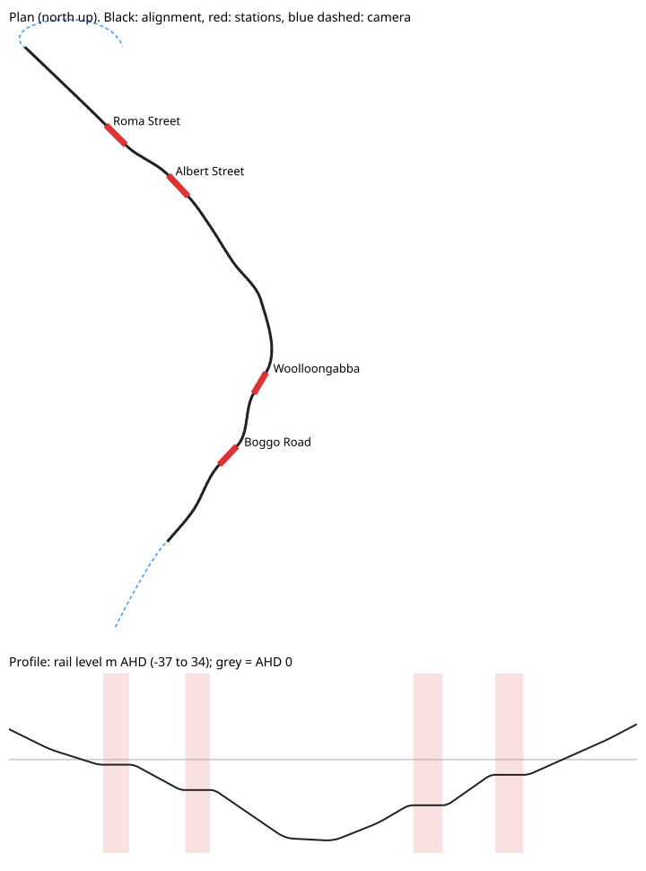
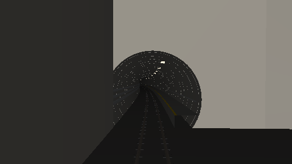
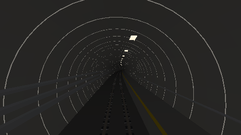
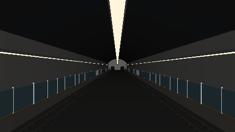

# Cross River Rail (Brisbane): Unreal Engine 5 photoreal flyby

This toolkit uses Python scripts to build an Unreal Engine 5 scene of Brisbane's **Cross River Rail**. It covers the twin tunnels, the four underground stations (Boggo Road, Woolloongabba, Albert Street and Roma Street) and both portals. A cine camera flies the whole route, and Movie Render Queue renders the sequence.

* **Underground:** the scripts generate the tunnels and stations procedurally from a geo-referenced alignment. They include segmental-lining ring joints, slab track with QR 1067 mm rails and baseplates, walkways, cable trays, luminaires, station caverns with platform screen doors, and portal troughs. The meshes import as Nanite, with Lumen GI and auto exposure that adapts like an eye between daylight and the tunnel.
* **Above ground:** Cesium for Unreal streams Google Photorealistic 3D Tiles, so the real city appears in the opening and closing aerial shots. The tiles use the same georeference as the tunnels.
* **Camera (~3.5 min at 24 fps):**
  1. An aerial shot over Dutton Park descends into the southern portal.
  2. The camera runs through the northbound tube at driver's eye height. In each station it slows down, rises and glides along the centre of the cavern.
  3. It passes under Kangaroo Point and the Brisbane River.
  4. It exits at Normanby and climbs into a reveal of the CBD skyline.



The previews below come from the built-in software renderer (`tools/preview.py`). They only check the geometry and do not show how the scene looks in Unreal.

| Southern portal | Tunnel | Albert Street |
|---|---|---|
|  |  |  |

## Accuracy: read this first

Cross River Rail's detailed design alignment and station architecture are not public. The route in `crr/route.py` approximates them from public information:

* station locations
* 5.9 km of twin tunnel bored with 7.2 m TBMs
* about 58 m below the surface at Kangaroo Point and about 42 m below the river
* Albert Street cavern about 290 m long and 34 m deep
* Roma Street cavern about 280 m long and 15 m high
* Boggo Road station about 19 m deep

The modelled tunnel is about 5.3 km from portal to portal. The station interiors are generic cavern designs and do not replicate the real architecture.

For a more faithful result:
1. Edit the waypoints in `crr/route.py` (latitude/longitude and rail level in m AHD). You can trace them from the EIS maps or from the portals visible in the 3D tiles. Every mesh, light and camera key is derived from that table.
2. Import real station architecture if you can get it (for example BIM or IFC through Datasmith) and hide the generated station meshes.

## Requirements

| | |
|---|---|
| Unreal Engine | 5.3–5.6 |
| Plugins | **Python Editor Script Plugin**, **Editor Scripting Utilities**, **Movie Render Queue**, **Interchange** (for OBJ import, on by default), **Cesium for Unreal** (free on Fab, for the city) |
| Project settings | Dynamic GI = Lumen, Reflections = Lumen, Generate Mesh Distance Fields = on, **Support Hardware Ray Tracing = on** (Lumen HW RT gives much better tunnel reflections), Virtual Shadow Maps = on |
| City tiles | A **Google Map Tiles API key** with the Map Tiles API enabled, **or** a **Cesium ion token**. Google requires on-screen attribution for any published render. Check their terms before commercial use. |
| GPU | RTX 3070 or better recommended. 4K final renders take hours. |

## Usage

1. Create a new blank UE5 project (Film/Video & Live Events → Blank). Enable the plugins above and restart the editor.
2. Copy this folder anywhere. Before launching the editor, set any of these optional environment variables:
   ```
   GOOGLE_MAPS_API_KEY=...      # or CESIUM_ION_TOKEN=...
   CRR_QUALITY=draft            # do a fast draft first; "final" is the default
   ```
3. In the editor, open the **Output Log**, switch the input to **Python** and run each step in turn:
   ```
   py "C:/path/to/cross_river_rail_unreal/unreal_scripts/build_scene.py"
   py "C:/path/to/cross_river_rail_unreal/unreal_scripts/create_flyby.py"
   py "C:/path/to/cross_river_rail_unreal/unreal_scripts/render_movie.py"
   ```
   * `build_scene.py` creates `/Game/CrossRiverRail/Maps/CRR_Flyby`, imports about 600 meshes (3.5 M triangles at final quality, about 320 k at draft), and creates materials, about 490 lights, post-processing, the sky and the Cesium city. Expect 10–40 minutes at final quality. Re-running it is safe.
   * `create_flyby.py` creates `LS_CRR_Flyby` with every frame keyed and markers for each station. Open it in Sequencer and press play to preview.
   * `render_movie.py` queues and starts a Movie Render Queue render. Choose a preset with `CRR_RENDER_PRESET`:
     - `draft`: 1 sample, TSR. Use it to check timing and framing.
     - `final` (default): Lumen, 16 temporal sub-samples for clean motion blur and converged GI, 3840×2160.
     - `pathtraced`: Path Tracer at 64 samples per frame. The most photoreal option and the slowest.
4. Encode the frames, which are written to `<Project>/Saved/MovieRenders/CRR/<preset>/`:
   ```
   ffmpeg -framerate 24 -i LS_CRR_Flyby.%05d.png -c:v libx264 -crf 16 -pix_fmt yuv420p -preset slow crr_flyby.mp4
   ```

### Lining the tunnels up with the 3D tiles

* `CRR_GEOID_SEPARATION_M` (default 40.6) converts AHD rail levels to the ellipsoid heights that Cesium uses. Check the value for Brisbane with the AUSGeoid2020 calculator.
* If the portal troughs sit slightly above or below the photogrammetry ground, set `CRR_VERTICAL_ADJUST_M` to raise or lower everything.
* The real ground mesh covers the portal mouths. To cut it away, add a **Cesium Cartographic Polygon** around each portal trough and a **Cesium Polygon Raster Overlay** on the tileset that references it. The Cesium panel does this in two clicks.

## Making it look more real

The geometry is already detailed. Most of the remaining realism comes from materials:

* **Materials:** every surface uses a material instance in `/Game/CrossRiverRail/Materials` (`MI_CRR_lining`, `MI_CRR_station_floor` and so on) with `BaseTex`, `NormalTex`, `Tiling`, `BaseColor`, `Roughness` and `Variation` parameters. Drop Quixel Megascans (Fab) concrete, terrazzo and metal textures into `BaseTex` and `NormalTex`. UVs are in metres, so `Tiling` is the number of repeats per metre. Re-running `build_scene.py` keeps your instance edits.
* **Lighting:** the `MI_CRR_led` emissive strength and the light lumens in `crr/meshgen.py → build_lights` control the tunnel mood. Lumen picks up the emissive luminaires as GI.
* **Sun:** the default is 4:30 pm on 15 August, which gives a warm, low sun over the CBD. Change it with `CRR_SUN_SOLAR_TIME`, `CRR_SUN_MONTH` and the related variables.
* **Trains:** a passing QR NGR or CRR train makes the shot. Add a train model from Fab and animate it in Sequencer along the right-hand track. For transforms, `crr.route.Alignment().point(chainage, +7.0, 0)` gives the position at any chainage.
* **Camera speeds** (m/s): `CRR_SPEED_TUNNEL` (default 60), `CRR_SPEED_STATION` (default 14), `CRR_SPEED_AERIAL` and related variables.

## How it works

```
crr/config.py      tunables (all overridable with CRR_* environment variables)
crr/geo.py         WGS84 → ENU → Unreal (+X east, +Y south, cm), matching Cesium's georeference
crr/route.py       alignment: Hermite spline (straight through stations) + vertical profile
                   with parabolic vertical curves (stations level), grade/radius checks
crr/meshgen.py     cross-section sweeps, holed end walls, chunking (200 m), OBJ + manifest
crr/camera.py      flight path, speed profile, look-ahead, per-frame keys
unreal_scripts/    editor scripts (build_scene / create_flyby / render_movie)
tools/preview.py   dependency-free software renderer and plan/profile SVG
tests/             python3 -m unittest discover -s tests
```

Unreal's OBJ importers apply their own unit and axis conversion. To handle this, `build_scene.py` first imports three tiny calibration meshes and measures the conversion from their bounds. It then writes the real meshes pre-transformed with the inverse, so they land exactly at their geo-referenced positions with correct face orientation, whichever importer version you have. A unit test simulates this with a Y-up, metres-based importer.

You can generate and inspect geometry without Unreal:
```
python3 -m crr.meshgen generated/meshes
python3 tools/preview.py generated/meshes 45 tunnel.png        # frame at t=45 s
python3 tools/preview.py --plan plan.svg
python3 -c "from crr.route import Alignment; print(Alignment().summary())"
```
